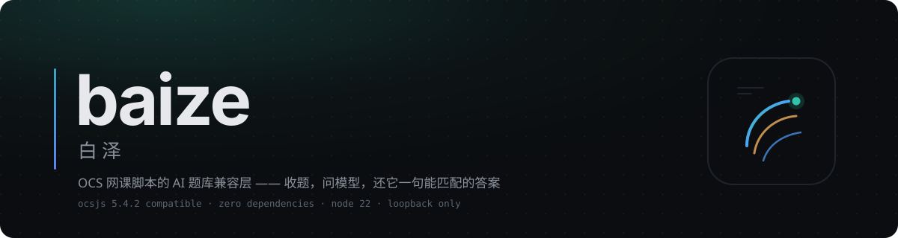
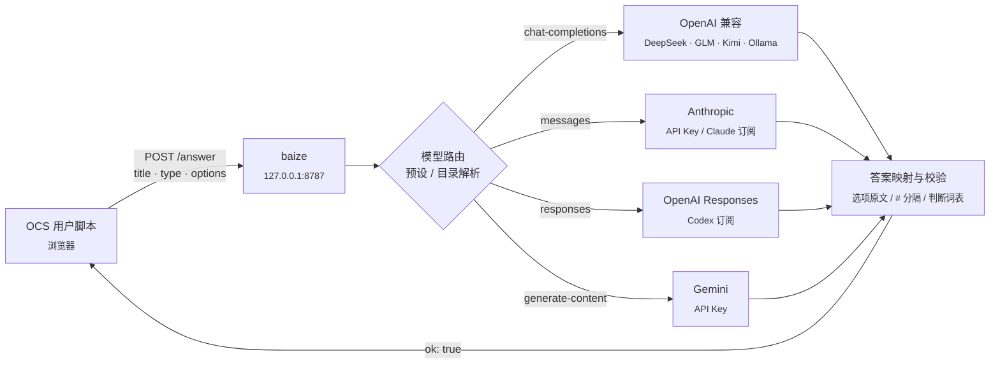
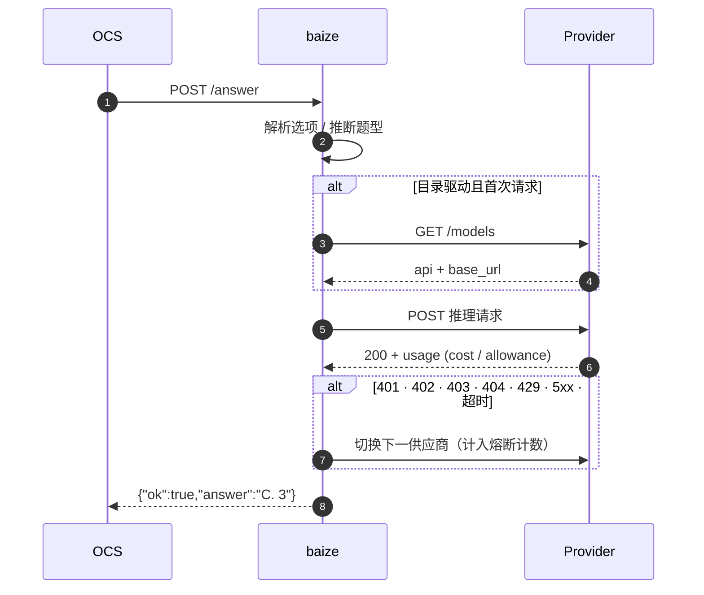
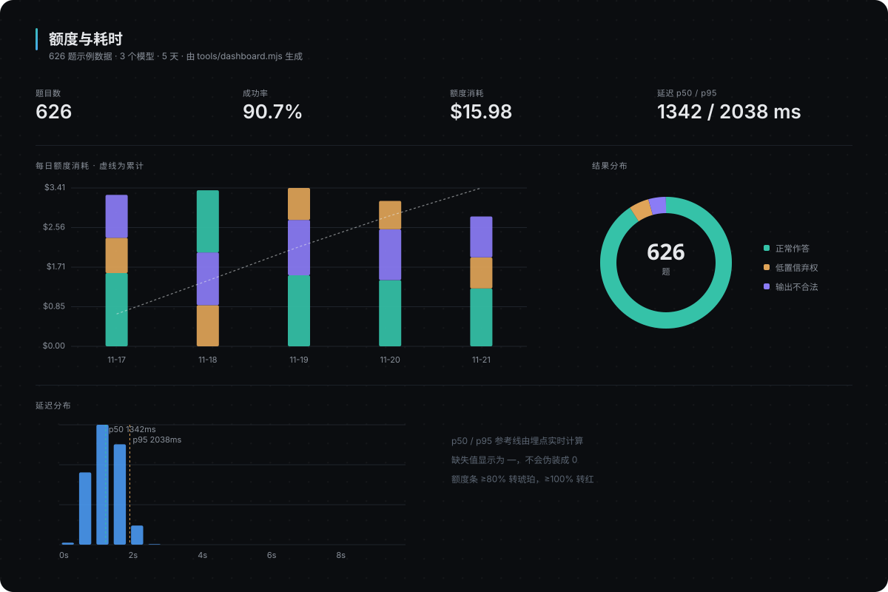

<div align="center">



<br>

<a href="https://github.com/Ghost-king-gk/baize/stargazers"></a>


<br><br>

**把 OCS 的「题库协议」，翻译成任意大模型的可靠答案。**

<sub>零运行时依赖 · 本地回环服务 · 多模型故障转移 · 单文件可视化看板 · 支持 OpenCode Go 与 Claude / ChatGPT 订阅</sub>

</div>

---

## 简介

[OCS（网课助手）](https://github.com/ocsjs/ocsjs) 将「题库」抽象为一个标准的外部 HTTP 服务：发送题目，接收答案字符串。它并不关心后端究竟是静态数据库，还是实时推理的大语言模型——只要接口说着它的「方言」即可。

**baize（白泽）** 正是这样一个运行在本机的轻量级协议翻译层：**接收题目 → 调度模型自洽推理 → 将模型选择精准映射回选项原文**。



### 定位与边界

| 维度 | 说明 |
| --- | --- |
| **本地协议桥接** | 仅监听 `127.0.0.1`，不出本机、无云端中转，API Key 完全由用户本地持有。 |
| **无题库、零侵入** | 不存储题库数据，也不修改 OCS 一行代码；OCS 升级无需重新适配，亦非浏览器扩展。 |
| **弃权优于猜错** | 模型只输出选项序号，由代码精确回填原文；任一环节置信度不足或格式异常即返回 `ok: false`，避免将错误答案写入页面。 |

---

## 快速上手

### 1. 启动服务

按你的运行环境选择一种方式：

<details open>
<summary><b>方式 A：Docker（推荐）</b></summary>

```bash
git clone https://github.com/Ghost-king-gk/baize.git && cd baize
cp .env.example .env          # 填入 OPENCODE_GO_API_KEY 或其他供应商密钥
docker compose up -d --build
```

宿主机仅暴露 `127.0.0.1:8787`。更多细节见 [docs/docker.md](docs/docker.md)。
</details>

<details>
<summary><b>方式 B：Windows（免安装 Node）</b></summary>

```powershell
git clone https://github.com/Ghost-king-gk/baize.git; cd baize
powershell -ExecutionPolicy Bypass -File scripts\win-portable.ps1
copy .env.example .env
notepad .env                  # 填入密钥
scripts\start.bat
```

`win-portable.ps1` 会将便携版 `node.exe` 下载至 `runtime\` 目录，无需在系统中全局安装 Node。详见 [docs/windows.md](docs/windows.md)。
</details>

<details>
<summary><b>方式 C：Linux / macOS（源码运行）</b></summary>

要求 **Node ≥ 22**：

```bash
git clone https://github.com/Ghost-king-gk/baize.git && cd baize
cp .env.example .env          # 填入密钥
node src/server.mjs
```
</details>

终端输出以下日志即表示启动成功：

```text
[baize] listening on http://127.0.0.1:8787  chain=opencode-go  model=glm-5.3-flash  k=3
```

### 2. 验证接口

```bash
curl -s -X POST 127.0.0.1:8787/answer \
  -H 'Content-Type: application/json' \
  -d '{"title":"1+2=?","type":"single","options":"A. 1\nB. 2\nC. 3\nD. 4"}'
# {"ok":true,"answer":"C. 3"}
```

> **离线联调**：无需联网或 API Key 即可测试整条链路：
> `ANSWERER_PROVIDER=mock ANSWERER_MOCK_LETTERS=3 node src/server.mjs`（固定选择第 3 个选项）。

### 3. 接入 OCS

打开任意网课页面 → 展开 OCS 面板 → `⚙️ 全局设置` → `题库配置` → 选择「自定义」→ 粘贴 [contract/answerer.json](contract/answerer.json)：

```json
[
  {
    "name": "白泽",
    "homepage": "http://127.0.0.1:8787",
    "url": "http://127.0.0.1:8787/answer",
    "method": "post",
    "type": "fetch",
    "responseType": "json",
    "headers": { "Content-Type": "application/json" },
    "data": { "title": "${title}", "type": "${type}", "options": "${options}" },
    "handler": "return (res)=> res && res.ok ? [undefined, res.answer] : undefined"
  }
]
```

- **`type: "fetch"`**：浏览器将 `127.0.0.1` 视作安全源，使用原生 `fetch` 即可直接通信，**无需**在油猴脚本元信息中手动添加 `@connect`。
- **`[undefined, res.answer]`**：OCS 官方支持的简写格式，题干留空时由 OCS 自动回填当前题目。

---

## 多模型路由与故障转移

供应商配置以数据驱动：内置预设位于 [config/providers.json](config/providers.json)，自定义覆盖可写在同目录的 `config/providers.local.json`（已加入 `.gitignore`）。

| Provider ID | 协议 | 认证方式 | 所需凭据 |
| --- | --- | --- | --- |
| `openai` / `deepseek` / `glm` / `kimi` / `minimax` / `openrouter` | `openai` | `api-key` | 对应供应商的 API Key |
| `anthropic` | `anthropic` | `api-key` | `ANTHROPIC_API_KEY` |
| `google` | `gemini` | `api-key` | `GEMINI_API_KEY` |
| `opencode` / `opencode-go` | 目录驱动 | `bearer` | `OPENCODE_GO_API_KEY` |
| `ollama` / `lmstudio` | `openai` | 无 | 本地运行的服务 |

协议（`protocol`）与认证（`auth`）正交解耦：`api-key` 模式自动适配各家原生认证头（`x-api-key` / `x-goog-api-key` / `Bearer`）；`bearer` 模式统一发送 `Authorization: Bearer`，不附带任何厂商私有 beta 或指纹头。

### 目录驱动路由（OpenCode）

OpenCode 的模型列表接口自带每个模型对应的协议键（`api`）与端点（`base_url`）。baize 在运行时拉取目录并按模型 ID 自动反查，无需手动维护 `baseUrl`：

```bash
ANSWERER_CHAIN=opencode-go ANSWERER_MODEL=glm-5.3-flash node src/server.mjs
```

| 目录 `api` 键 | 映射协议 | 实际请求路径 |
| --- | --- | --- |
| `chat-completions` | `openai` | `{base_url}/chat/completions` |
| `responses` | `responses` | `{base_url}/responses` |
| `messages` | `anthropic` | `{base_url}/messages` |
| `generate-content` | `gemini` | `{base_url}/models/<model>:generateContent` |

- **严格唯一匹配**：仅识别上述四个键；过滤后必须**恰好命中一个**，0 个或多个均直接报错，绝不猜测。
- **缓存与容错**：目录按 URL 缓存 10 分钟；拉取失败视为可切换故障，模型不存在则视为配置错误。
- **会话与权限**：预设已通过 `${session}` 自动注入必需的 `x-opencode-session` 请求头（缺失会触发 400 `MissingSessionID`）；免费模型仅限 OpenCode 客户端使用（第三方调用返回 403），需使用付费模型或 Go 订阅。

### 故障转移与熔断

通过 `ANSWERER_CHAIN`（如 `openai,deepseek,ollama`）可将多个供应商串联为降级链。**混合链必须为每个供应商显式指定 `model`**，否则服务会在启动阶段直接拒绝，避免运行到半途才触发 404。



| 异常类型 | 处理策略 |
| --- | --- |
| 网络错误、超时、`408` / `429` / `5xx`、非 JSON 响应 | 记一次失败，切换链中下一家 |
| `401` / `402` / `403` / `404` | 视为密钥失效、额度耗尽或模型不可用，切换下一家 |
| `400` 及其他 `4xx` | **立即终止并抛出**，避免继续消耗后续供应商额度 |
| `2xx` 但内容截断、空输出或序号非法 | 供应商服务本身正常，不切换链路，按 `invalid_output` 原地重试一次 |
| 单供应商连续失败 3 次 | 进程内熔断 **60 秒**，冷却结束后自动恢复探测 |

```text
[baize] provider=openai status=429 -> fallback=deepseek
[baize] provider=openai status=401 provider_auth_failed -> fallback=deepseek
[baize] provider=openai circuit=open
```

<details>
<summary><b>进阶：自定义 Provider 与 Claude / Codex 订阅 OAuth</b></summary>

#### 自定义 Provider

在 `config/providers.local.json` 中按 ID 浅合并到预设表即可：

```json
{
  "my-gateway": {
    "label": "我的网关",
    "protocol": "openai",
    "baseUrl": "https://gateway.example.com/v1",
    "keyEnv": "MY_GATEWAY_API_KEY",
    "model": "some-model"
  }
}
```

#### 订阅 OAuth（实验性，风险自负）

- **Claude 订阅（`auth: oauth`）**：携带 `Bearer` + `anthropic-version: 2023-06-01` + `anthropic-beta: claude-code-20250219,oauth-2025-04-20`；自动读取 `~/.claude/.credentials.json` 中的 `claudeAiOauth.accessToken`，过期会在启动时报错。设置 `impersonate: true` 时额外发送 `x-app: cli` 与 Claude Code UA，并在 Prompt 首行注入身份声明。
- **Codex 订阅（`auth: codex-oauth`）**：走 Responses API，携带 `Bearer` + `chatgpt-account-id`（提取自 JWT claim `https://api.openai.com/auth.chatgpt_account_id`）+ `originator: codex_cli_rs`；凭据取自 `~/.codex/auth.json`。
- **关于 Gemini**：公开 SDK 仅支持 API Key 与 Vertex，Gemini CLI 的 OAuth 走 Code Assist 内部端点，无公开等价路径，因此暂不实现。

> ⚠️ **风险提示**：此类 Token 隶属于官方订阅客户端，第三方调用可能违反服务条款或随时被吊销。订阅模式目前**未在真实账号上完成联调**。

</details>

---

## 看板与用量监控



> <sub>上图由内置看板生成器渲染（示例数据：626 题 / 3 个模型 / 5 天）。</sub>

服务运行期间自带轻量级只读 Web 界面与状态接口，同时提供命令行工具用于离线生成报表：

```bash
node tools/quota.mjs       # 刷新 OpenCode Go 各模型月度额度（无需 API Key）
node tools/dashboard.mjs   # 生成独立单文件 dashboard.html，浏览器直接打开
```

| 路由 | 用途 |
| --- | --- |
| `/` | 运行概览：服务状态、当前链路、模型与最近 10 条答题记录 |
| `/dashboard` | 实时渲染的用量与额度看板 |
| `/settings` | **只读**配置页：环境变量脱敏展示（密钥仅露前 4 位）与一键复制的 OCS 配置 |
| `/api/status` | JSON 格式的运行状态，供外部脚本集成 |

> **计费与安全说明**
> - **额度以 `allowance` 为准**：OpenCode Go 订阅内 `cost` 恒为 `0`，实际扣减月度上限的是 `usage.opencode.allowance`。
> - **区分 `null` 与 `0`**：`cost: null` 表示上游未返回费用字段，`cost: 0` 表示订阅内免费；无额度表时页面如实标注「无额度表」，不虚构上限。额度使用率达 ≥80% 显示琥珀色预警，≥100% 转为红色。
> - **浏览器无写权限**：修改任何配置均需编辑 `.env` 并重启服务，Web 端不暴露写入入口。

---

## 技术参考

日常使用无需关心以下细节；如需二次开发、排查异常或审计行为，可按需展开查阅。

<details>
<summary><b>1. OCS 答案格式与匹配契约</b></summary>

OCS 的答题器依赖**字符串匹配**而非语义理解，返回格式直接决定能否正确选中选项：

| 题型 | 期望返回格式 | OCS 源码依据与注意事项 |
| --- | --- | --- |
| `single` | 选中选项的**原文**（保留 `A.` 等前缀） | `resolvers/single.ts:27` 先归一化匹配再计算相似度；两侧均经过 `removeRedundant`（`utils/string.ts:250`），前缀会对称剥离。 |
| `multiple` | 多个选项原文，以 `#` 连接 | `resolvers/multiple.ts:42`；OCS 支持的分隔符全集为 `['===','#','---','###','\|',';','；']`（`worker/utils.ts:139`）。 |
| `judgement` | **词表 Token**（如 `对/错/正确/错误/√/×/true/1`），**严禁**带 `A.` 前缀 | `resolvers/judgement.ts:9-29` 定义词表，`:40` 执行整串相等比对；`A. 正确` 归一化后变为 `a正确` 导致失配。 |
| `completion` | 按空位顺序以 `#` 连接 | `resolvers/completion.ts:19` 调用 `splitAnswer` 切分后依次填入。 |

**核心约束**：
- **只让模型输出序号，由代码映射回选项原文**：让模型自行复述选项文本，本质是在赌 OCS 的 `0.6` 相似度阈值。
- **不返回纯字母**：返回 `A`/`B` 会退化到优先级更低的 `plainOptions` 兜底路径。
- **判断题 Token 必须取自选项自身**：若页面选项为 `√`，返回 `正确` 无法命中。
- **填空题防冲突**：若生成答案本身包含 `#` 或 `===` 会破坏切分逻辑，此时直接弃权。

</details>

<details>
<summary><b>2. 模型调用与自洽采样（Self-Consistency）</b></summary>

- **确定性参数**：统一采用 `temperature: 0`、非流式、无工具调用；`max_tokens` 选择题设为 `256`、填空题设为 `1200`（推理模型的 thinking 过程会消耗输出预算，实测 `16` 时会返回空串）。
- **去位置偏置投票**：选项以 `1) 2) 3)` 编号展示，Prompt 仅要求输出序号（如 `3` 或 `1,3`）。同一题通过 `Promise.all` 并行采样 **K 次**，每次**独立随机打乱选项顺序**，将输出映射回原始下标后取多数票。
- **置信度与重试**：未达成过半共识返回 `low_confidence`；单次样本解析失败会就地重试一次，仍失败则返回 `invalid_output`。当供应商支持返回 `logprobs` 时，额外取 Top-2 概率差作为 `margin` 参与判定。

</details>

<details>
<summary><b>3. HTTP 接口与错误码（reason）</b></summary>

请求体字段与 OCS 的 `env` 结构保持一致（`answer.wrapper.handler.ts:46-66`），支持：`title`、`type`、`options`（`\n` 分隔字符串）、`images`（base64 数组）、`suggestion_title`、`suggestion_options`。

```json
// 成功
{ "ok": true, "answer": "C. 3" }

// 弃权或失败
{ "ok": false, "reason": "low_confidence" }
```

| `reason` | HTTP 状态码 | 含义 |
| --- | --- | --- |
| `low_confidence` | `200` | K 次采样未形成过半共识，或 `margin` 低于阈值 |
| `invalid_output` | `200` | 模型输出无法解析、序号越界、重复或数量不符（重试一次仍失败） |
| `provider_error` | `200` | 网络错误、非 2xx 或响应结构异常（重试一次仍失败） |
| `unsupported_images` | `200` | 请求包含图片，当前版本不支持多模态 |
| `invalid_request` | `400` | 请求体本身不合法 |

> 所有业务层面的主动弃权均返回 HTTP `200`（供 OCS 正常按「未搜到」处理），仅请求格式非法时返回 `400`。

</details>

<details>
<summary><b>4. 环境变量一览</b></summary>

| 变量名 | 默认值 | 说明 |
| --- | --- | --- |
| `ANSWERER_CHAIN` | 空 | 故障转移链，逗号分隔（如 `openai,deepseek,ollama`），优先级高于 `ANSWERER_PROVIDER` |
| `ANSWERER_PROVIDER` | `openai` | 单供应商兼容写法；设为 `mock` 可离线调试 |
| `ANSWERER_PROVIDERS_FILE` | `config/providers.json` | 预设表路径；同目录下的 `providers.local.json` 会自动合并 |
| `ANSWERER_MODEL` | 空 | 单供应商链的全局模型；混合链须逐家配置 `model` |
| `ANSWERER_HOST` | `127.0.0.1` | 监听地址；**仅在容器内部应设为 `0.0.0.0`** |
| `ANSWERER_PORT` | `8787` | 监听端口 |
| `ANSWERER_K` | `3` | 自洽采样次数，范围 `1–10` |
| `ANSWERER_MARGIN` | `0.15` | 置信度边际阈值，仅在 `logprobs` 可用时生效 |
| `ANSWERER_TIMEOUT_MS` | `20000` | 单次模型请求超时时间（毫秒） |
| `ANSWERER_LOG` | `1` | 设为 `0` 关闭 JSONL 埋点日志 |
| `ANSWERER_LOG_FILE` | `logs/answers.jsonl` | 埋点日志路径 |
| `ANSWERER_LOGPROBS` | `0` | 设为 `1` 请求 `logprobs`（仅对 `openai` 协议生效） |
| `ANTHROPIC_OAUTH_TOKEN` / `OPENAI_OAUTH_TOKEN` | 空 | 订阅 OAuth Token，优先级高于本地凭据文件 |
| `OPENAI_ACCOUNT_ID` | 空 | Codex 模式的 `chatgpt-account-id` 手动覆盖值 |

服务严格限定只读取 `ANSWERER_*`、预设表中 `keyEnv` 声明的变量以及上述三个 OAuth 变量，不会自动拾取宿主机上的其他密钥。

</details>

<details>
<summary><b>5. 埋点日志与费用口径</b></summary>

每次答题以单行 JSONL 追加写入 `logs/answers.jsonl`（已加入 `.gitignore`），写入失败不会阻塞答题主流程：

```json
{"ts":"2026-11-21T07:12:18.788Z","type":"single","title_len":5,"title_hash":"aee7...","options_n":4,
 "provider":"opencode-go","model":"glm-5.3-flash","input_tokens":210,"output_tokens":4,
 "reasoning_tokens":0,"cached_tokens":0,"cost":0,"list_cost":0.0006,"allowance":0.0000021,
 "billing_source":"go","letters":[3],"margin":null,"votes":{"3":3},"ms":863,
 "outcome":"ok","effective_type":"single"}
```

| 字段 | 协议映射来源 | 缺失值 |
| --- | --- | --- |
| `input_tokens` | openai `usage.prompt_tokens`；anthropic `usage.input_tokens`；gemini `usageMetadata.promptTokenCount`；responses `usage.input_tokens` | `null` |
| `output_tokens` | 各协议对应的 `completion_tokens` / `candidatesTokenCount` / `output_tokens` | `null` |
| `reasoning_tokens` | openai `completion_tokens_details.reasoning_tokens`；gemini `thoughtsTokenCount`；responses `output_tokens_details.reasoning_tokens`；anthropic 不提供 | `null` |
| `cached_tokens` | openai `prompt_tokens_details.cached_tokens`；anthropic `cache_read_input_tokens`；gemini `cachedContentTokenCount`；responses `input_tokens_details.cached_tokens` | `null` |
| `cost` | `usage.cost`（实际扣费） | `null` |
| `list_cost` | `opencode.list_cost`（按官方标价折算） | `null` |
| `allowance` | `opencode.allowance`（占用的订阅计划额度） | `null` |
| `billing_source` | `opencode.billing_source`（`go` / `go-plus` / `balance` / `free` / `byok`） | `null` |

- **严格累加口径**：K 次自洽采样每次均产生真实计费，日志按次累加；只要任一样本缺失某字段，该项汇总记为 `null`（部分已知不等于完整账单）。
- **隐私脱敏**：日志仅记录题干长度与 SHA-256 前 16 位，**不保存题干原文**；填空题的 `votes` 仅统计各候选样本的出现频次。

</details>

<details>
<summary><b>6. 测试与评测</b></summary>

```bash
node --test                        # 运行全部 129 项测试（格式化 / Prompt / 协议 / 路由 / 配置 / 服务 / HTTP / 管理页 / 看板）
node --test eval/format.test.mjs   # 单独运行真实用例格式评测（已包含在全量测试中）
```

`eval/cases.json` 逐字节复用自 ocsjs 仓库的 `tests/cases.json`（commit `09628b7`，MIT License，Copyright (c) 2022 enncy，SHA-256 `12feb6c6...`），测试套件内置防篡改校验。159 个用例中 137 个为可作答用例，其余 22 个 `expect: []` 为本身无解的负例。

</details>

---

## 安全与已知限制

### 安全边界

- **严格本地回环**：默认仅绑定 `127.0.0.1`；Docker 内的 `0.0.0.0` 仅作用于容器网络，宿主机端口依然只发布在回环地址。
- **CORS 权衡**：为兼容任意网课域名下的页面原生 `fetch`，服务返回 `Access-Control-Allow-Origin: *` 并放行 `OPTIONS` 预检。这意味着本机浏览器中任意网页理论上均可向 `127.0.0.1:8787` 发起跨域 POST；若对此敏感，请在防火墙层限制。
- **`handler` 执行风险**：OCS 题库配置中的 `handler` 会在页面上下文通过 `new Function` 执行。务必固定本地地址并仅粘贴经本人审查的配置，切勿从远端动态拉取题库配置。
- **切勿暴露公网**：本工具面向本机单用户设计，**无鉴权、无限流**，请勿将其反向代理至公网。

### 已知限制

- **不支持图片题**：请求中 `images` 非空时直接返回 `unsupported_images`，不猜测、不静默降级。
- **多行选项可能错位**：OCS 将选项以 `\n` 拼接为纯字符串传递，若单个选项内部包含换行符，解析后的选项下标将发生偏移。
- **`type: unknown` 依赖启发式推断**：两选项呈一正一误推断为判断，有选项推断为单选，无选项推断为填空；可通过日志中的 `effective_type` 复盘误判。
- **置信度与知识边界**：Anthropic 与 Gemini 不返回 `logprobs`，此时仅依赖 K 次投票；此外，自洽投票只能过滤不稳定输出，无法纠正模型「稳定且自信地答错」。
- **故障转移不覆盖内容错误**：上游返回 `2xx` 但格式非法时仅原地重试一次，不触发供应商切换，以免将内容问题误判为服务故障。
- **未实现特性**：暂不支持指数退避、并发上限控制、响应缓存、多模态输入及流式输出。

---

## 项目结构与设计取舍

```text
.
├── src/
│   ├── server.mjs          # HTTP 入口：/answer /health /dashboard /settings /api/status
│   ├── config.mjs          # 环境变量解析、故障转移链与目录型 Provider 配置
│   ├── providers.mjs       # 预设表合并、认证模式与请求头占位符替换
│   ├── router.mjs          # 故障转移调度、进程内熔断与目录路由解析
│   ├── service.mjs         # 自洽采样、多数票决策、弃权逻辑与 JSONL 埋点
│   ├── catalog.mjs         # OpenCode 模型目录客户端（10 分钟 TTL 缓存）
│   ├── oauth.mjs           # Claude / Codex 订阅凭据读取
│   ├── protocols/          # 协议实现：openai · anthropic · gemini · responses
│   └── web/                # 可视化看板与只读状态页
├── tools/                  # CLI 工具：quota.mjs（额度刷新）· dashboard.mjs（看板生成）
├── contract/answerer.json  # OCS 自定义题库配置片段
├── config/                 # Provider 预设表与额度快照
├── scripts/                # Windows 便携启动脚本（start.bat · win-portable.ps1）
└── docs/                   # 专题文档：windows · docker · dashboard
```

### 为什么这样设计？

- **零运行时依赖**：仅使用 Node 内置模块（`node:http` / `node:fs` / `node:crypto`）与全局 `fetch`。无需 `npm install` 即可「复制即跑」，Docker 镜像秒级构建，也便于未来打包为单文件。
- **手写协议，不引入官方 SDK**：官方 SDK 本质是 HTTP 封装、重试与类型定义，却会引入数十 MB 依赖；本项目只需要「一次非流式 JSON 请求 + 提取文本」，手写协议更透明可控。
- **使用 `.mjs` + JSDoc 而非 TypeScript**：规避部分 Node 编译环境未启用原生 TS 支持（`ERR_NO_TYPESCRIPT`）的问题，通过 JSDoc 补充类型提示，且 `node --test` 无需任何额外参数即可直接运行。
- **弃权优先原则**：任何不确定场景一律返回 `ok: false` 交由人工处理，宁可留空也不向答题页面写入猜测结果。

---

<div align="center">
<sub>

**免责声明**：本项目仅供学习与自动化技术研究，请严格遵守所在学校及平台的使用条款。作者不提供任何绕过平台风控的能力，亦不对使用后果承担责任。

<br><br>

MIT License · 兼容 ocsjs 5.4.2 @ 09628b7 · [上游仓库](https://github.com/ocsjs/ocsjs)

<br>

名出《山海经》：「白泽知万物之情」——知万物，且能言人语。

</sub>
</div>
