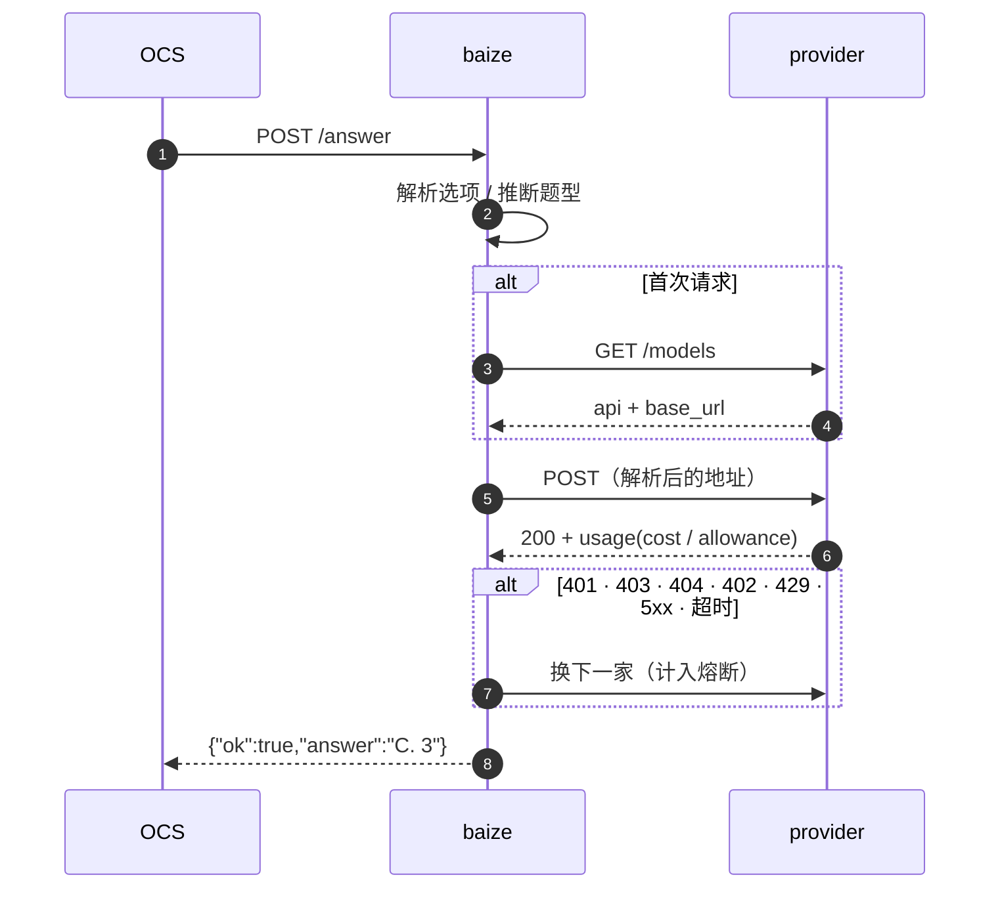

<div align="center">


<br>

<a href="https://github.com/Ghost-king-gk/baize/stargazers"></a>


<br><br>

**把 OCS 的「题库」协议，翻译成任意 LLM 的答案。**

<sub>零依赖 · 单文件看板 · 只绑回环 · 支持 Claude / ChatGPT 订阅与 OpenCode Go</sub>

</div>

<br>

<table>
<tr>
<td align="center" width="33%"><h3>0</h3><sub>运行时依赖<br><code>node:http</code> 就是全部</sub></td>
<td align="center" width="33%"><h3>4</h3><sub>线协议<br>OpenAI · Anthropic · Responses · Gemini</sub></td>
<td align="center" width="33%"><h3>1</h3><sub>个进程<br>没有数据库、没有队列、没有守护</sub></td>
</tr>
</table>

---

## 它是什么

OCS（网课助手）把「题库」当成一个**外部 HTTP 服务**：发一道题，拿回一个字符串。
所以它不需要题库，只需要一个说它方言的东西。

baize 就是这个东西：**收题 → 问模型 → 把模型的选择映射回题目里的选项原文**。


## 它不是什么

| | |
| --- | --- |
| ❌ 不是题库网站 | 没有题目数据，也不需要。只负责把题转给模型 |
| ❌ 不是浏览器扩展 | 是一个本地 HTTP 服务，浏览器只跟它说话 |
| ❌ 不是 OCS 的分支 | 不改 OCS 一行代码，升级 OCS 不用重新适配 |
| ❌ 不是云服务 | 只监听 `127.0.0.1`，不出本机。你要自己填 key |

---

## 一分钟启动

<details open>
<summary><b>Docker（最省事）</b></summary>

```bash
git clone https://github.com/Ghost-king-gk/baize.git && cd baize
cp .env.example .env          # 填 OPENCODE_GO_API_KEY
docker compose up -d --build
```

只发布 `127.0.0.1:8787`。详见 [docs/docker.md](docs/docker.md)。
</details>

<details>
<summary><b>Windows（免安装 Node）</b></summary>

```powershell
git clone https://github.com/Ghost-king-gk/baize.git; cd baize
powershell -ExecutionPolicy Bypass -File scripts\win-portable.ps1
copy .env.example .env
notepad .env                  # 填 key
scripts\start.bat
```

`win-portable.ps1` 会把 `node.exe` 下到 `runtime\`，系统里不用装 Node。详见 [docs/windows.md](docs/windows.md)。
</details>

<details>
<summary><b>Linux / macOS（源码）</b></summary>

```bash
git clone https://github.com/Ghost-king-gk/baize.git && cd baize
cp .env.example .env
node src/server.mjs
```

要求 Node ≥ 22。
</details>

看到这一行就算起来了：

```text
[baize] listening on http://127.0.0.1:8787  chain=opencode-go  model=glm-5.3-flash  k=3
```

自检：

```bash
curl -s -X POST 127.0.0.1:8787/answer \
  -H 'Content-Type: application/json' \
  -d '{"title":"1+2=?","type":"single","options":"A. 1\nB. 2\nC. 3\nD. 4"}'
# {"ok":true,"answer":"C. 3"}
```

> 不想联网：`ANSWERER_PROVIDER=mock ANSWERER_MOCK_LETTERS=3 node src/server.mjs`，固定回答第 3 个选项。

---

## 接进 OCS

打开网课页面 → OCS 面板 → `⚙️ 全局设置` → `题库配置` → 自定义 → 粘贴 [`contract/answerer.json`](contract/answerer.json)：

```json
[
  {
    "name": "白泽",
    "homepage": "http://127.0.0.1:8787",
    "url": "http://127.0.0.1:8787/answer",
    "method": "post",
    "type": "fetch",
    "responseType": "json",
    "headers": { "Content-Type": "application/json" },
    "data": { "title": "${title}", "type": "${type}", "options": "${options}" },
    "handler": "return (res)=> res && res.ok ? [undefined, res.answer] : undefined"
  }
]
```

> `type: "fetch"` 是刻意的：本地回环被浏览器视作安全源，**不需要**在脚本元信息里加 `@connect`。
> `[undefined, answer]` 是官方支持写法——题目留空，OCS 自动回填当前题干。

---

## 答案格式：真正容易做错的地方

OCS 的匹配器不是「读懂答案」，是**字符串匹配**。所以服务返回什么，决定了它能不能选中。

| 题型 | 必须返回 | 依据 |
| --- | --- | --- |
| `single` | 选中选项的**原文**（含 `A.` 前缀） | `resolvers/single.ts:27` 先归一化匹配再相似度；两侧同过 `removeRedundant`（`utils/string.ts:250`），前缀对称剥离 |
| `multiple` | 多个选项原文，`#` 连接 | `resolvers/multiple.ts:42`；分隔符全集 `['===','#','---','###','|',';','；']`（`worker/utils.ts:139`） |
| `judgement` | **词表 token**（`对/错/正确/错误/√/×/true/1`），不能带 `A.` 前缀 | `resolvers/judgement.ts:9-29` 定义词表，`:40` 做整串相等：`A. 正确` 归一化后是 `a正确`，匹配不上 |
| `completion` | `#` 连接，按空位顺序 | `resolvers/completion.ts:19` 用 `splitAnswer` 切分后依次填 |

**让模型只输出序号，再由代码映射回请求里的选项原文** —— 让模型复述选项等于把 0.6 相似度阈值当赌注。

- 绝不返回 `A`/`B` 纯字母（那会走 `plainOptions` 兜底，优先级更低）
- 判断题的 token 必须来自**选项自身**：选项是 `√` 就返回 `√`，返回 `正确` 匹配不上
- 填空答案里出现 `#` 或 `===` 会破坏切分 → 直接弃权

> 任何一环不可靠就返回 `ok:false`，OCS 走「搜不到」。**弃权优于猜错**：猜错的答案会被写进 DOM，甚至被交卷。

---

## 多 provider 与故障转移

供应商是**数据**：预设表在 [`config/providers.json`](config/providers.json)，本地覆盖放 `config/providers.local.json`（已 gitignore）。

| id | 协议 | auth | 需要什么 |
| --- | --- | --- | --- |
| `openai` / `deepseek` / `glm` / `kimi` / `minimax` / `openrouter` | openai | `api-key` | 各家 key |
| `anthropic` | anthropic | `api-key` | `ANTHROPIC_API_KEY` |
| `google` | gemini | `api-key` | `GEMINI_API_KEY` |
| `opencode` / `opencode-go` | 目录驱动 | `bearer` | `OPENCODE_GO_API_KEY` |
| `ollama` / `lmstudio` | openai | 无 | 本地服务 |

`protocol` 与 `auth` 正交：`api-key` 用供应商原生头（`x-api-key` / `x-goog-api-key` / Bearer），`bearer` 一律 `Authorization: Bearer` 且不加任何供应商特有的 beta / 指纹头。

### 目录驱动：OpenCode 不用填 baseUrl

模型列表接口自带每个模型该用哪种 API（`api` 键 + `base_url`），所以 baize 在运行时拉目录、按模型 id 反查：

```bash
ANSWERER_CHAIN=opencode-go ANSWERER_MODEL=glm-5.3-flash node src/server.mjs
```

| `api` 键 | protocol | 最终请求 |
| --- | --- | --- |
| `chat-completions` | `openai` | `{base_url}/chat/completions` |
| `responses` | `responses` | `{base_url}/responses` |
| `messages` | `anthropic` | `{base_url}/messages` |
| `generate-content` | `gemini` | `{base_url}/models/<model>:generateContent` |

- 只认这四个键，过滤后**恰好剩一个**才用；剩 0 个或 ≥2 个都报错，不猜
- 目录缓存 10 分钟，按 URL 复用实例；拉取失败算「可切换错误」，模型不存在算配置错误
- 必须带 `x-opencode-session`（缺了 400 `MissingSessionID`），预设已用 `${session}` 占位符自动生成
- 免费模型只在 OpenCode 客户端内可用，第三方 403；必须用付费模型或 Go 订阅

### 故障转移



| 情况 | 行为 |
| --- | --- |
| 网络错误、超时、408 / 429 / 5xx、响应不是 JSON | 记一次失败，换下一家 |
| 401 / 403 / 404 / **402** | 同样换下一家（key 过期、模型不存在、额度耗尽） |
| 400 及其余 4xx | **立即抛出**，不继续烧别家额度 |
| 2xx 但内容截断 / 空输出 / 序号非法 | 不切下一家（供应商已应答），按 `invalid_output` 重试一次 |
| 单 provider 连续失败 3 次 | 进程内熔断 60 秒，冷却后自动放行 |

```text
[baize] provider=openai status=429 -> fallback=deepseek
[baize] provider=openai status=401 provider_auth_failed -> fallback=deepseek
[baize] provider=openai circuit=open
```

> **混合链必须逐家写 model**（不同供应商模型名不同），否则启动即拒绝，不会拖到第一次请求才发现第二家 404。

<details>
<summary><b>自定义 provider / 订阅 OAuth</b></summary>

在 `config/providers.local.json` 里按 id 浅合并到预设表：

```json
{
  "my-gateway": {
    "label": "我的网关",
    "protocol": "openai",
    "baseUrl": "https://gateway.example.com/v1",
    "keyEnv": "MY_GATEWAY_API_KEY",
    "model": "some-model"
  }
}
```

**Claude 订阅**（`auth: oauth`）：Bearer + `anthropic-version: 2023-06-01` + `anthropic-beta: claude-code-20250219,oauth-2025-04-20`；凭据取 `~/.claude/.credentials.json` 的 `claudeAiOauth.accessToken`，过期会启动即报错。`impersonate: true` 时额外发 `x-app: cli` 与 Claude Code UA，并在 prompt 首行注入身份声明。

**Codex 订阅**（`auth: codex-oauth`）：走 Responses API，Bearer + `chatgpt-account-id`（JWT claim `https://api.openai.com/auth.chatgpt_account_id`）+ `originator: codex_cli_rs`；凭据取 `~/.codex/auth.json`。

**风险自负**：这类 token 属于订阅客户端，第三方调用可能违反供应商条款，也可能随时被吊销。**Gemini 没有等价路径**——公开 SDK 只有 API key 与 Vertex，CLI 的 OAuth 走 Code Assist 内部端点，所以不实现。订阅模式未在真实账号上联调过。
</details>

---

## 额度与看板


> 上图由真实看板生成器输出（示例数据：626 题 / 3 个模型 / 5 天）。

```bash
node tools/quota.mjs       # 刷新 Go 各模型月额度（无需 key）
node tools/dashboard.mjs   # 生成 dashboard.html，浏览器直接打开
```

- **`allowance` 才是额度**：Go 订阅内 `cost` 恒为 `0`，真正计入月度上限的是 `usage.opencode.allowance`
- **空值不是 0**：`cost: null` 表示没有数据，`cost: 0` 表示订阅内免费
- 额度条 ≥80% 转琥珀、≥100% 转红；没有额度表就显示「无额度表」，不编造上限

服务运行时还有四个入口：

| 路径 | 内容 |
| --- | --- |
| `/` | 状态、链路、模型、最近 10 条答题 |
| `/dashboard` | 上面那张看板，实时生成 |
| `/settings` | **只读**配置：环境变量（key 只露前 4 位）+ 可复制的 OCS 题库配置 |
| `/api/status` | JSON，给脚本用 |

改配置仍然走 `.env` + 重启——不给浏览器留写入口。

---

<details>
<summary><b>埋点字段与费用口径</b></summary>

每题一行 JSONL，追加到 `logs/answers.jsonl`（已 gitignore）：

```json
{"ts":"2026-11-21T07:12:18.788Z","type":"single","title_len":5,"title_hash":"aee7...","options_n":4,
 "provider":"opencode-go","model":"glm-5.3-flash","input_tokens":210,"output_tokens":4,
 "reasoning_tokens":0,"cached_tokens":0,"cost":0,"list_cost":0.0006,"allowance":0.0000021,
 "billing_source":"go","letters":[3],"margin":null,"votes":{"3":3},"ms":863,
 "outcome":"ok","effective_type":"single"}
```

| 字段 | 来源 | 缺失时 |
| --- | --- | --- |
| `input_tokens` | openai `usage.prompt_tokens`；anthropic `usage.input_tokens`；gemini `usageMetadata.promptTokenCount`；responses `usage.input_tokens` | `null` |
| `output_tokens` | 对应各家的 completion / candidatesTokenCount / output_tokens | `null` |
| `reasoning_tokens` | openai `completion_tokens_details.reasoning_tokens`；gemini `thoughtsTokenCount`；responses `output_tokens_details.reasoning_tokens`；anthropic 不提供 | `null` |
| `cached_tokens` | openai `prompt_tokens_details.cached_tokens`；anthropic `cache_read_input_tokens`；gemini `cachedContentTokenCount`；responses `input_tokens_details.cached_tokens` | `null` |
| `cost` | `usage.cost`：本次实际扣费 | `null` |
| `list_cost` | `opencode.list_cost`：按标价折算 | `null` |
| `allowance` | `opencode.allowance`：占用的计划额度 | `null` |
| `billing_source` | `opencode.billing_source`：`go` / `go-plus` / `balance` / `free` / `byok` | `null` |

- K 次自洽采样每次都真实计费，日志按次累加；任一样本缺字段则整项记 `null`（部分已知 ≠ 完整账单）
- 只记题干长度 + sha256 前 16 位，**不记题干原文**；填空题的 `votes` 只记「第几个样本出现几次」
- 写日志失败不影响答题主流程

</details>

<details>
<summary><b>环境变量</b></summary>

| 变量 | 默认 | 说明 |
| --- | --- | --- |
| `ANSWERER_CHAIN` | 空 | 故障转移链，逗号分隔（`openai,deepseek,ollama`），优先于 `ANSWERER_PROVIDER` |
| `ANSWERER_PROVIDER` | `openai` | 单 provider 兼容写法；`mock` 不联网 |
| `ANSWERER_PROVIDERS_FILE` | `config/providers.json` | 预设表；同目录 `providers.local.json` 自动合并 |
| `ANSWERER_MODEL` | 空 | 单 provider 链的全局模型；混合链必须逐家写 `model` |
| `ANSWERER_HOST` | `127.0.0.1` | 监听地址；**只有容器里才该设成 `0.0.0.0`** |
| `ANSWERER_PORT` | `8787` | 监听端口 |
| `ANSWERER_K` | `3` | 自洽采样次数，1–10 |
| `ANSWERER_MARGIN` | `0.15` | 置信度阈值，仅 logprobs 可用时生效 |
| `ANSWERER_TIMEOUT_MS` | `20000` | 单次模型请求超时 |
| `ANSWERER_LOG` | `1` | `0` 关闭埋点 |
| `ANSWERER_LOG_FILE` | `logs/answers.jsonl` | 埋点文件 |
| `ANSWERER_LOGPROBS` | `0` | `1` 时请求 logprobs（只对 openai 协议生效） |
| `ANTHROPIC_OAUTH_TOKEN` / `OPENAI_OAUTH_TOKEN` | 空 | 订阅 token，优先于凭据文件 |
| `OPENAI_ACCOUNT_ID` | 空 | Codex 的 `chatgpt-account-id` 覆盖值 |

服务只读 `ANSWERER_*`、预设表里 `keyEnv` 指定的变量，以及 OAuth 三个变量；宿主机上其它 key 不会被自动采用。

</details>

<details>
<summary><b>请求 / 响应 / reason</b></summary>

请求字段与 OCS 的 `env` 一致（`answer.wrapper.handler.ts:46-66`）：`title` / `type` / `options`（`\n` 分隔的字符串）/ `images`（base64 数组）/ `suggestion_title` / `suggestion_options`。

```json
{ "ok": true, "answer": "C. 3" }
{ "ok": false, "reason": "low_confidence" }
```

| reason | 含义 |
| --- | --- |
| `low_confidence` | K 次采样没有过半共识，或 margin 低于阈值 |
| `invalid_output` | 输出无法解析 / 序号越界 / 重复 / 数量不符，重试一次仍失败 |
| `provider_error` | 网络、非 2xx、结构异常，重试一次仍失败 |
| `unsupported_images` | 请求带图片，v1 不支持多模态 |
| `invalid_request` | 请求本身不合法（HTTP 400） |

业务弃权返回 HTTP 200；只有 `invalid_request` 返回 400。

</details>

<details>
<summary><b>模型调用与自洽采样</b></summary>

- 统一 `temperature: 0`、不流式、无工具；`max_tokens` 选择题 256、填空 1200（推理模型的 thinking 会吃掉小预算，16 时实测返回空串）
- prompt 只要求输出序号：`3` 或 `1,3`；选项以 `1) 2) 3)` 展示
- 同一题并行打 K 次（`Promise.all`），每次**独立打乱选项顺序**（同时消位置偏置），映射回原始下标后取多数票
- 没有过半共识 → `low_confidence`；任一次解析失败 → 该次重试一次，仍失败 → `invalid_output`
- provider 返回 logprobs 时取 top-2 概率差作为 margin；多数网关不返回，此时只靠投票

</details>

<details>
<summary><b>测试与评测</b></summary>

```bash
node --test                        # 129 项：格式化 / prompt / 协议 / 路由 / 配置 / 服务 / HTTP / 管理页 / 看板
node --test eval/format.test.mjs   # 真实用例评测（也在 node --test 里）
```

`eval/cases.json` 逐字节复制自 ocsjs 的 `tests/cases.json`（commit `09628b7`，MIT，Copyright (c) 2022 enncy），sha256 `12feb6c6...`，测试里有断言防篡改。159 个用例中 137 个可作答（22 个 `expect: []` 是本来就无解的负例）。

</details>

---

## 安全

- **默认只绑 `127.0.0.1`**；容器场景下的 `0.0.0.0` 只存在于容器内，宿主机仍只发布回环端口
- OCS 用页面原生 `fetch`（跨域），因此服务返回 `Access-Control-Allow-Origin: *` 并处理 `OPTIONS` 预检
- **题库配置里的 `handler` 等价于在页面里执行代码**（`new Function`）。所以地址要固定、只贴你自己审查过的配置，不要做「从远端动态拉题库配置」
- 已知边界：任何网页都能向 `127.0.0.1:8787` 发跨域 POST（这是兼容任意网课域名的代价）。只监听回环、不暴露公网；介意的话在防火墙层限制
- 无鉴权、无限流：本机单用户工具，**不要直接反代到公网**

## 已知限制

- **图片题未实现**：`images` 非空一律 `unsupported_images`，不猜、不静默降级
- **多行选项会错位**：OCS 把选项按 `\n` 拼成一个字符串，选项内部含换行时下标会对不上（OCS 传过来时就丢了结构）
- **`type: unknown` 靠推断**：两选项一正一误 → 判断；有选项 → 单选；无选项 → 填空。推断错就答错，日志里 `effective_type` 可复盘
- **margin 通常不可用**：Anthropic / Gemini 没有 logprobs，置信度主要靠 K 次投票
- **LLM 会「自信地答错」**：自洽投票只过滤不稳定输出，过滤不了稳定的错误知识
- **故障转移不覆盖内容错误**：2xx 但格式错只重试一次，不换供应商（避免把内容问题误判为故障）
- 没有指数退避、没有并发上限、没有响应缓存、没有多模态、没有流式

## 目录结构

```text
.
├── src/
│   ├── server.mjs        HTTP：/answer /health /dashboard /settings /api/status
│   ├── config.mjs        env、链路、目录型 provider
│   ├── providers.mjs     预设表合并、auth 模式、headers 占位符
│   ├── router.mjs        故障转移、熔断、目录解析
│   ├── service.mjs       自洽采样、多数票、弃权、埋点
│   ├── catalog.mjs       OpenCode 模型目录（TTL 缓存）
│   ├── oauth.mjs         Claude / Codex 订阅凭据
│   ├── protocols/        openai · anthropic · gemini · responses
│   └── web/              看板与只读管理页
├── tools/                quota.mjs（额度表）· dashboard.mjs（CLI）
├── contract/answerer.json  OCS 侧要贴的那段配置
├── config/               provider 预设 · 额度快照
├── scripts/              start.bat · win-portable.ps1
└── docs/                 windows · docker · dashboard
```

## 为什么这样设计

- **零运行时依赖**：只用 `node:http` / `node:fs` / `node:crypto` / 全局 `fetch`。不装包才能「复制即跑」、`docker build` 秒级完成、将来能打成单文件
- **手写协议，不引官方 SDK**：SDK 本质是 HTTP + 重试 + 类型，换来几十 MB 依赖和锁死的打包方式；这里只需要「一次非流式 JSON 请求 + 取一段文本」
- **`.mjs` 而不是 `.ts`**：本机 Node 编译时未启用 TypeScript 支持（`ERR_NO_TYPESCRIPT`），用 JSDoc 注解补类型，`node --test` 不需要任何 flag
- **弃权优先**：所有不确定都返回 `ok:false`，让用户手填，而不是把猜的答案写进页面

---

<div align="center">
<sub>

**免责声明** · 本项目仅供学习与自动化技术研究，请遵守所在学校/平台的使用条款。
作者不提供绕过平台风控的能力，也不对使用后果负责。

<br><br>

MIT License · 兼容 ocsjs 5.4.2 @ 09628b7 · [上游仓库](https://github.com/ocsjs/ocsjs)

<br>

名字取自《山海经》：「白泽知万物之情」——知万物，且能言人语。

</sub>
</div>
